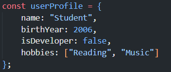
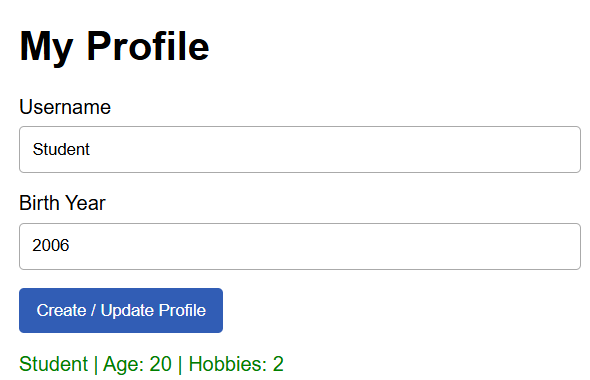
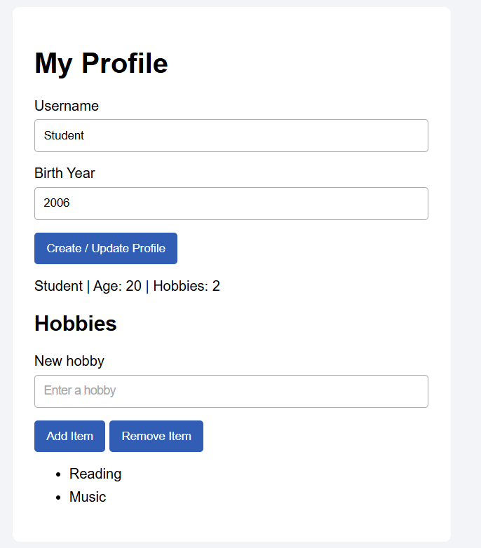
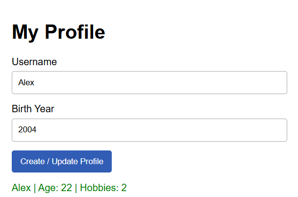
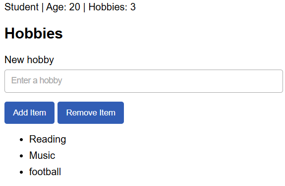

# Assignment 5

Name: Ainabek Chingiskhan 

Group: IT-2502 

## Run the project

Keep index.html, style.css and script.js in the same folder. Open index.html in a browser.

Student and 2006 are example profile values. Change them in script.js or update the profile using the form.

## Part 1

### Task 1 Personal info object

The const object userProfile contains a string name, a number birthYear, a boolean isDeveloper and an array hobbies. The object is also logged to the browser console.

Screenshot: 

### Task 2 Arithmetic calculations

The current year is obtained with new Date().getFullYear(). Age is calculated as current year minus birth year. The additional metric is the number of hobbies, obtained with hobbies.length. Both values appear on the page.

Screenshot: 

## Part 2

### Task 3 HTML form

The form contains Username and Birth Year inputs and a Create / Update Profile button.

Screenshot: 

### Task 4 Event listener

A submit listener reads the inputs and updates userProfile. preventDefault() keeps the page from reloading. Number() converts the birth year to a number. The profile text becomes green after an update.

Screenshot: 

## Part 3

### Task 5 Creating and removing elements

Add Item adds a nonempty hobby to the array and creates a new li element. Remove Item removes the last li and the last hobby from the array. The hobby count stays synchronized with the list. Removing an item from an empty list does not cause an error.

Screenshot: 

## Work process

The HTML defines the form and list. The CSS sets the page layout, colors and spacing. JavaScript stores the profile, calculates the age and connects the buttons to the page. The form uses required fields and numeric limits. JavaScript handles empty text and an empty list.

## Submission checklist

- Replace the name and group placeholders.
- Add the screenshots below their corresponding task headings.
- Upload all project files to a public GitHub repository.
- Publish the site with GitHub Pages.
- Submit both the repository URL and the GitHub Pages URL.
- Attend the mandatory practical defense.
